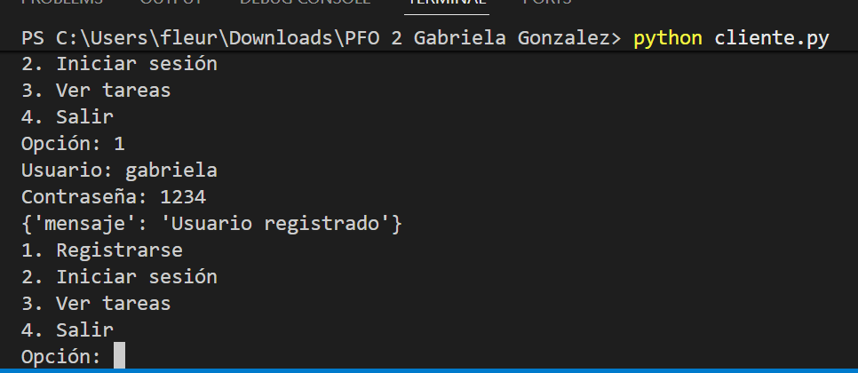
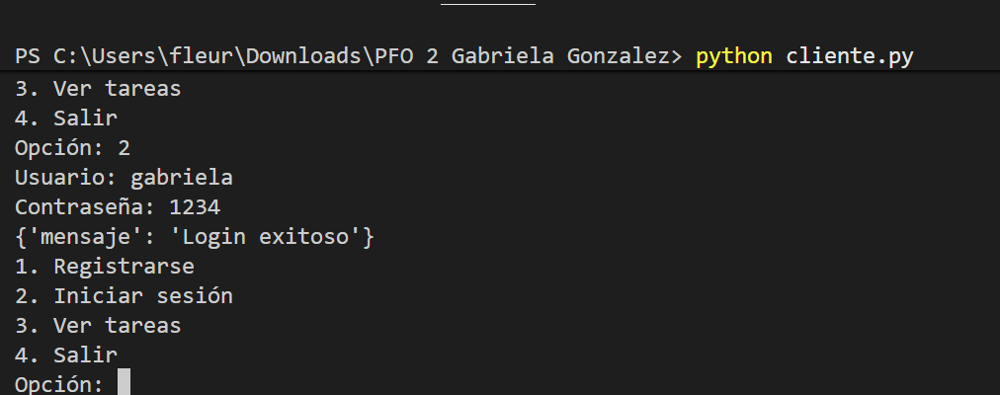
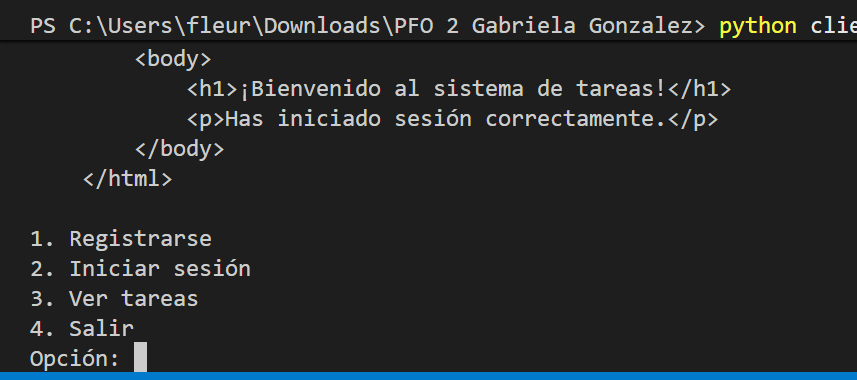
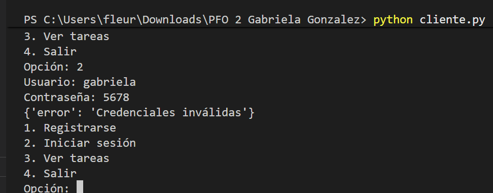
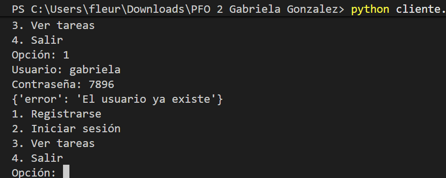
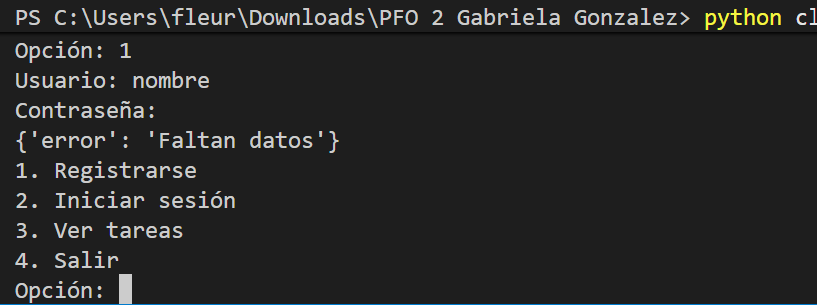

# PFO 2 - Sistema de Gestión de Tareas con API y Base de Datos
**Materia:** Programación sobre redes - 3° Comisión D  
**Alumno:** Gabriela Gonzalez

## Descripción

Sistema de gestión de tareas con una API REST hecha en Flask y una base de datos SQLite. Permite registrar usuarios con contraseñas hasheadas, iniciar sesión y ver un HTML de bienvenida.

## Objetivos

1. Implementar una API REST con endpoints funcionales.
2. Utilizar autenticación básica con protección de contraseñas.
3. Gestionar datos persistentes con SQLite.
4. Construir un cliente en consola que interactúe con la API.

## Tecnologías usadas

- Python 3
- Flask
- SQLite
- Werkzeug (para hashear contraseñas)
- Requests (para el cliente de consola)

## Estructura del proyecto
PFO 2 Gabriela Gonzalez/
├── servidor.py
├── cliente.py
├── tareas.db (se crea automáticamente)
└── README.md

## Requisitos

1. Instalar las dependencias:

```bash
py -m pip install flask requests
```
## Ejecución
### Paso 1: Iniciar el Servidor API
En una terminal ejecutar el servidor:
```bash
python servidor.py
```
El servidor queda corriendo en http://127.0.0.1:5000

### Paso 2: Iniciar el Cliente de Consola
En otra terminal distinta se ejecuta el cliente de consola:
```bash
python cliente.py
```
Se abre el menú interactivo para registrar un usuario, iniciar sesión, ver la bienvenida y gestionar tareas.

## Especificación de Endpoints de la API
### 1. Registro de Usuarios: `POST /registro`
Da de alta un usuario y almacena la contraseña hasheada en SQLite.
- **Body (JSON):**
  ```json
  {
    "usuario": "gabriela",
    "contraseña": "1234"
  }
  ```
  **Respuestas:**
  - mensaje: Usuario registrado. 
  - error: Faltan datos.
  - error: El usuario ya existe.

### 2. Inicio de Sesión: `POST /login`
Comprueba las credenciales contra el hash en base de datos y habilita el acceso.
- **Body (JSON):**
  ```json
  {
    "usuario": "gabriela",
    "contraseña": "1234"
  }
  ```
- **Respuestas:**
  - "mensaje": "Login exitoso"
  - "error": "credenciales inválidas"

  ## Ver tareas
  `GET /tareas`
  Devuelve un HTML de bienvenida


## Capturas de pantalla

### 1. Registro de usuario


### 2. Inicio de sesión


### 3. Ver tareas (HTML de bienvenida)


### 4. Error Credenciales inválidas


### 5. Error Usuario ya existente


### 6. Error Faltan datos



  ## Alojamiento en GitHub Pages

El proyecto está alojado en GitHub Pages: https://tu-usuario.github.io/tu-repositorio/

  ## Respuestas Conceptuales

  ### 1. ¿Por qué hashear contraseñas?
  Hashear contraseñas es relevante porque brinda protección ante robo de la base de datos. En caso que un atacante acceda a la misma, no puede leer las contraseñas reales. El hash es una función irreversible pues a partir del hash no se puede obtener la contraseña original. Además, guardar contraseñas en texto plano es una mala práctica ya que cualquiera con acceso a la base de datos (administradores, atacantes, empleados) podría verlas y usarlas. Muchos usuarios reutilizan contraseñas en varios servicios. Si la base de datos se filtra y las contraseñas están hasheadas, los atacantes no pueden usarlas para acceder a otras cuentas del usuario. Asimismo, al usar generate_password_hash de Werkzeug, se agrega una salt aleatoria a cada contraseña antes de hashearla. Esto evita que dos usuarios con la misma contraseña tengan el mismo hash, y protege contra ataques de tablas precalculadas (rainbow tables).

 ### 2. Ventajas de usar SQLite en este proyecto
 SQLite es una base de datos liviana, embebida y sin servidor. Sus ventajas para este proyecto son:

1. No requiere servidor aparte: a diferencia de MySQL o PostgreSQL, SQLite no necesita instalar ni configurar un servidor de base de datos. Todo se maneja desde un archivo.

2. Viene integrado de forma nativa en la biblioteca estándar de Python (sqlite3), de esa manera no hay que realizar instalaciones extra.

3. Persistencia simple: todos los datos se guardan en un solo archivo (tareas.db). Esto facilita su entrega, respaldo y ejecución.

4. Es adecuado para proyectos pequeños y prototipos donde no se necesita alta concurrencia ni grandes volúmenes de datos.

5. Posee escalabilidad limitada: SQLite está diseñado para escenarios de baja a moderada concurrencia. Utiliza un modelo de bloqueo a nivel de base de datos (database-level locking) para las operaciones de escritura, lo que significa que solo un escritor puede acceder a la base a la vez. Esto limita su escalabilidad horizontal y lo hace inadecuado para sistemas distribuidos de alta disponibilidad o cargas con múltiples escritores concurrentes. Sin embargo, para aplicaciones con lecturas predominantes y volúmenes moderados de datos, su rendimiento es adecuado y suficiente.

6. Compatibilidad: funciona en cualquier sistema operativo (Windows, Linux, macOS) sin configuración adicional.

7. Seguridad básica: permite consultas parametrizadas lo que ayuda a prevenir inyección SQL.

8. Cumple con las propiedades de Atomicidad, Consistencia, Aislamiento y Durabilidad (**ACID**), es decir, protege la integridad de los datos ante apagados abruptos o errores.
  